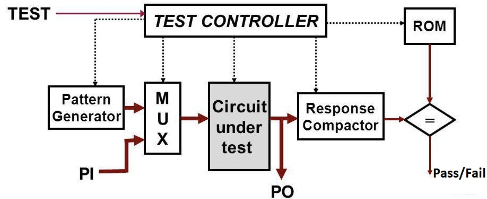

# Ripple Carry Adder BIST

Built-In Self-Test (BIST) for a 4-bit ripple carry adder in SystemVerilog.

## Architecture
- 9-bit LFSR for pseudorandom test pattern generation
- 4-bit ripple carry adder (CUT) with parameterizable stuck-at fault injection
- 5-bit MISR for response compaction
- FSM-based test controller (runs 511 test vectors)
- Golden signature comparator

## Structure
- `RTL/` design files
- `TB/` testbench (`bist_top_tb.sv`)

## Tools
SystemVerilog, Xilinx Vivado
